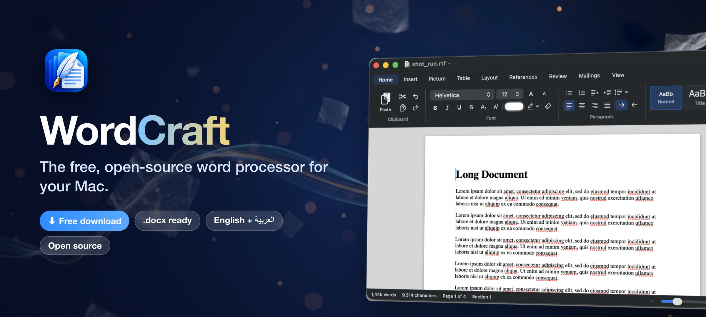
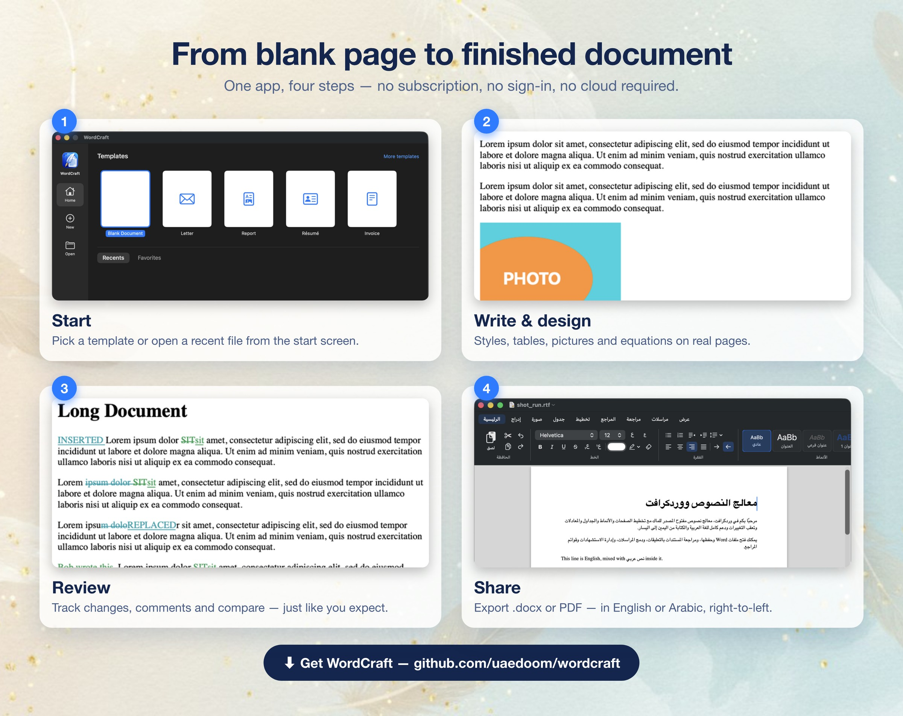
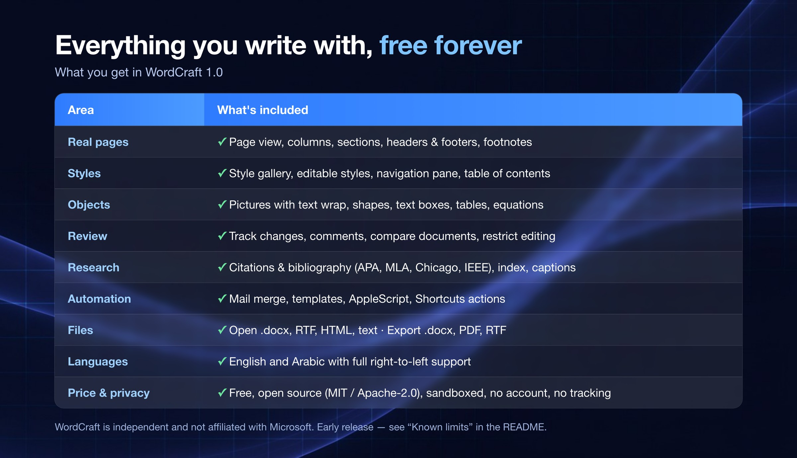

<p align="center"><a href="https://uaedoom.github.io/wordcraft/"></a></p>

<p align="center">
<a href="https://github.com/uaedoom/wordcraft/releases/download/v1.0.0/WordCraft-1.0.dmg"><b>⬇ Download WordCraft 1.0 (.dmg)</b></a> &nbsp;·&nbsp; <a href="https://uaedoom.github.io/wordcraft/"><b>🌐 Website</b></a> &nbsp;·&nbsp; <a href="https://github.com/uaedoom/wordcraft/releases">All releases</a>
</p>

<p align="center">
   
</p>

WordCraft is a native macOS app (SwiftUI + AppKit/TextKit) with real page layout, styles, tables, equations, track changes, citations, mail merge, `.docx` import/export, and full Arabic / right-to-left support. It is **not affiliated with Microsoft**; it reads and writes the open Office Open XML (`.docx`) format and borrows the familiar ribbon-style layout. It contains no Microsoft code or assets.

> **Status:** early release. It is usable for everyday writing, but it is not yet a full replacement for Microsoft Word. See [Known limits](#known-limits).

<p align="center"></p>

## What's in the box

| Area | Features |
|---|---|
| **Writing** | Fonts, sizes, bold/italic/underline/strike, super/subscript, colours, highlights, lists, indents, tabs, spacing, find & replace, spelling & grammar, thesaurus, word count |
| **Pages** | Real page view with margins, page size, orientation, columns, page/column/section breaks, headers & footers with page numbers, footnotes at the bottom of the page, endnotes |
| **Styles & structure** | Style gallery (Title, Heading 1–6, Quote…), editable styles, navigation pane, table of contents, captions, cross-references, bookmarks, index |
| **Objects** | Pictures (inline or floating with text wrap, resize, crop, alt text), shapes, text boxes, tables (merge/split, borders, shading, formulas), hyperlinks, symbols, equations (LaTeX-style input) |
| **Review** | Track changes (per author, accept/reject), comments with replies, compare documents, restrict editing (read-only / comments / tracked changes / forms) |
| **Power features** | Mail merge from CSV, citations & bibliography (APA, MLA, Chicago, IEEE), content controls (text, drop-down, date, check box), templates, **AppleScript** and **Shortcuts** actions |
| **Files** | Native `.wmdoc` package; opens `.docx`/`.dotx`, RTF, text and HTML; exports `.docx`, PDF, RTF, HTML, text; autosave and Versions from macOS |
| **Mac polish** | Arabic and English UI (right-to-left mirroring), VoiceOver labels, Focus Mode, Touch Bar, Settings, start screen with templates and recents |

<p align="center"></p>

## Get started

Requirements: macOS 15 or newer, Xcode 16 or newer, and [XcodeGen](https://github.com/yonaskolb/XcodeGen) (`brew install xcodegen`).

```bash
git clone https://github.com/uaedoom/wordcraft.git
cd wordcraft
xcodegen generate            # creates WordMac.xcodeproj from project.yml
open WordMac.xcodeproj       # then press Run
```

Command-line build:

```bash
xcodebuild -project WordMac.xcodeproj -scheme WordMac -configuration Debug -derivedDataPath build build
open build/Build/Products/Debug/WordCraft.app
```

> The Xcode project is generated, so it is not checked in. Edit `project.yml` to change targets, settings or entitlements.

## Downloads

Download from the [WordCraft website](https://uaedoom.github.io/wordcraft/) or the [Releases](../../releases) page (direct link: [WordCraft-1.0.dmg](https://github.com/uaedoom/wordcraft/releases/download/v1.0.0/WordCraft-1.0.dmg)). The DMG runs on Apple silicon Macs with macOS 15+. Each release includes a `SHA256SUMS.txt` file. The app is signed with an ad-hoc signature only, so macOS shows an "unidentified developer" warning the first time: right-click the app and choose **Open**.

## Automation

AppleScript:

```applescript
tell application "WordCraft"
    insert text "Hello from AppleScript. "
    replace text "colour" with "color"
    apply style "Heading 1"
    count words
end tell
```

Shortcuts: the *Insert Text*, *Append Text*, *Get Document Text*, *Find and Replace*, *Apply Style*, *Count Words* and *New Document* actions appear in the Shortcuts app.

## Known limits

- Vector clip art (EMF/WMF), SmartArt, charts and grouped shapes in `.docx` files are skipped.
- Tracked formatting changes are not recorded (text changes are).
- Table columns can't be resized by dragging yet.
- Page breaks can differ slightly from Microsoft Word because the layout engines differ.
- Citations and bibliographies are written to `.docx` as plain text, not as Word citation sources.
- Word files open as copies: *File ▸ Save* creates a `.wmdoc`; use *File ▸ Export As* to write `.docx`.

## Documentation

- [`docs/ARCHITECTURE.md`](docs/ARCHITECTURE.md): how the editor, page engine and file formats fit together
- [`CONTRIBUTING.md`](CONTRIBUTING.md): how to build, test and send changes
- [`APPSTORE.md`](APPSTORE.md): notes for shipping to the Mac App Store
- [`AGENTS.md`](AGENTS.md): orientation for AI coding agents

## License

Dual-licensed under either of

- [MIT license](LICENSE-MIT)
- [Apache License, Version 2.0](LICENSE-APACHE)

at your option. The WordCraft name and icon are not covered by these licenses. "Microsoft" and "Word" are trademarks of Microsoft Corporation and are used here only to describe file-format compatibility. See [`ATTRIBUTION.md`](ATTRIBUTION.md) for third-party notes.
